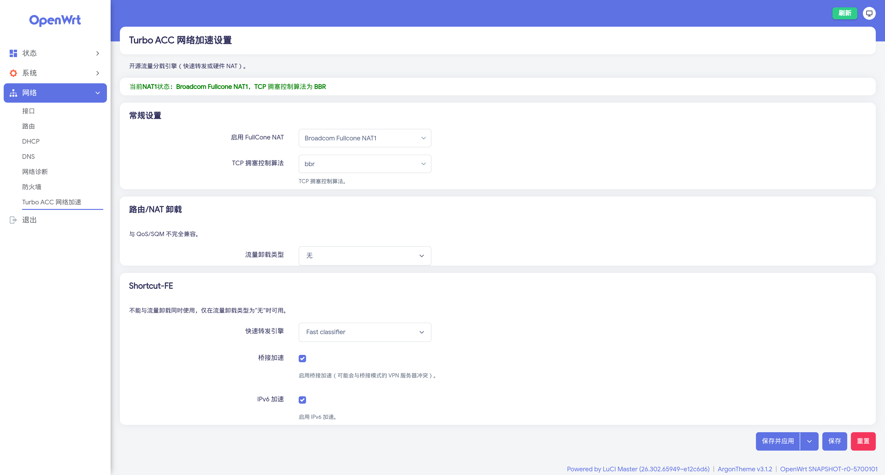
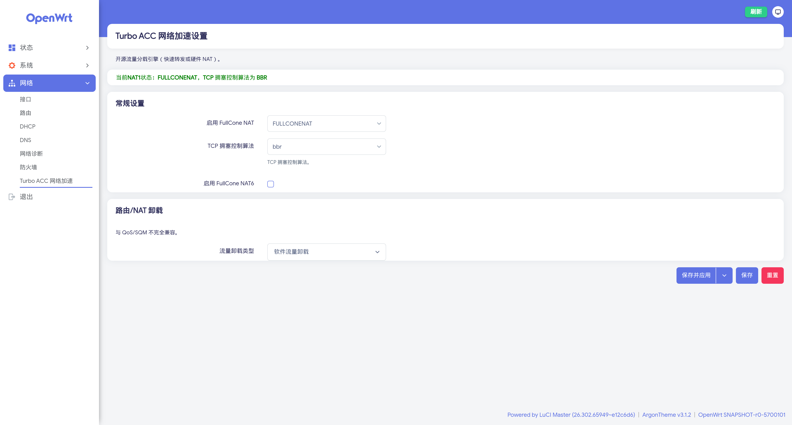

# luci-app-turboacc

[简体中文](./README.md) | English

A turboacc package for the official OpenWrt (24.10 / 25.12 / snapshot) with both firewall3 and firewall4 support.

It bundles the following features:

- Fast forwarding engine (Flow Offloading / Shortcut-FE / Fast Classifier)
- Fullcone NAT1
- TCP congestion control algorithms

Supported kernel versions: **6.6**, **6.12**, **6.18**.

> **If you only need fullcone NAT and not the other turboacc acceleration engines**, take a look at the standalone project **[openwrt-sonic-fullcone](https://github.com/mufeng05/openwrt-sonic-fullcone)**. It is built on SONiC's fullcone NAT kernel patches, supports both fw3 and fw4, offers per-zone and per-protocol granularity, comes with a LuCI web UI, and does not require any extra kernel modules.

Last tested on 2026-11-05: fw3 (iptables) and fw4 (nftables) firmware built from the x86_64 OpenWrt snapshot (r0-5c5a157, Linux 6.18.60) passed in QEMU, covering the settings page (including saving and applying from the page), every fullcone NAT1 mode, software flow offloading, the hardware offloading protocols (on a VM made to report hardware offloading support), Fast Classifier (fw3), the TCP congestion control setting and the migration of settings from older versions. It has not been tested on real hardware yet.

## Usage

1. From the root of your OpenWrt source tree, run:

    ```bash
    curl -sSL https://raw.githubusercontent.com/mufeng05/turboacc/main/add_turboacc.sh -o add_turboacc.sh && bash add_turboacc.sh
    ```

    The script automatically detects the kernel, firewall4, nftables and libnftnl versions of your source tree and applies the matching patches.

2. Then run:

    ```bash
    make menuconfig
    ```

3. Under **LuCI → 3. Applications**, enable `luci-app-turboacc`.

## Settings page

After lede removed `luci-app-turboacc`, it moved the fullcone NAT1, TCP congestion control and flow offloading settings into its firewall page. The TurboACC page in this repository ports that part of lede's current firewall page, with the same wording and translations as lede:

- At the top: the current NAT1 status and TCP congestion control algorithm
- General Settings: Enable FullCone NAT (`FULLCONENAT` / `Broadcom Fullcone NAT1`), TCP CCA, Enable FullCone NAT6 (fw4 only)
- Routing/NAT Offloading: flow offloading type (software or hardware flow offloading, plus MediaTek HNAT and Qualcomm NSS ECM on devices that have them); with hardware flow offloading on fw4, also the hardware offloading protocols (IPv4+v6 or IPv4 only)
- Shortcut-FE: Fast classifier / SFE connection manager, bridge acceleration, IPv6 acceleration. lede no longer offers this part; it is kept from lede's last turboacc version and is only available when the flow offloading type is None

As in lede, the first three parts are stored directly in the firewall config (the `defaults` section of `/etc/config/firewall`: `fullcone`, `fullcone6`, `tcpcca`, `flow_offloading`, `flow_offloading_hw`, `flow_offloading_hw_ipv6`), while the Shortcut-FE settings are stored in `/etc/config/turboacc`. The TCP congestion control algorithm is applied by the firewall on fw4 (a lede firewall4 patch) and by turboacc on fw3. On a fresh install, compatible fullcone NAT and software flow offloading are enabled by default when the firmware has the modules for them, and the TCP congestion control algorithm defaults to cubic as in lede (BBR can be chosen on the page); upgrading from an older version migrates the existing settings automatically.

In public lede, the hardware offloading protocols and MediaTek HNAT exist only on the page. This repository's firewall4 patch (`custom/patches/firewall4/patches/100-*.patch`) implements them the way lede's current firmware (QWRT) does: with "IPv4 acceleration", only IPv4 flows are offloaded and IPv6 takes the normal forwarding path, and the setting has no effect when hardware offloading is unavailable; with MediaTek HNAT, no flowtable is set up and the firewall init script switches HNAT on.

## Notes

1. **Prefer `Flow Offloading`.** `Flow Offloading` is the kernel-native flow offload mechanism (introduced in 4.16+). It is fully compatible with nftables and can be further offloaded to hardware, making it the long-term recommended acceleration path.
2. **Use `Flow Offloading` on `firewall4` (nftables).** `Shortcut-FE` and `Fast Classifier` depend on the iptables-era conntrack chain events interface and are not compatible with nftables. OpenWrt 23.05+ defaults to `firewall4` / nftables, so picking an SFE-style engine in that environment is risky.
3. **Only pick `Fast Classifier` or `Shortcut-FE` on `firewall3` (iptables).** If your firmware still uses `firewall3` / iptables, set the flow offloading type to None, then choose `Fast classifier` or `SFE connection manager` in the Shortcut-FE section.
4. Because OpenWrt now uses `firewall4` as the default firewall, if you switch back to `firewall3` you must manually deselect every nft-related package and replace it with the corresponding ipt package (for example, replace `iptables-nft` with `iptables-zz-legacy`).
5. **Both fullcone NAT1 modes work on `firewall3` and `firewall4`**, matching the current lede implementation. The `FULLCONENAT` (compatible) mode uses a fullcone NAT kernel module (`xt_FULLCONENAT` on fw3, `nft_fullcone` on fw4). The `Broadcom Fullcone NAT1` mode is implemented by kernel patches; on fw4 it maps to nftables' `masquerade fullcone` (added by lede on 2026-10-03). When fw4 starts it checks whether the selected mode is available and falls back to plain masquerade if it is not. Older versions lacked the patches fw4 needs for the Broadcom mode, which caused the problem in [#11](https://github.com/mufeng05/turboacc/issues/11). `firewall4` also supports IPv6 fullcone NAT (NAT6); tick "Enable FullCone NAT6" on the page to turn it on.

## Preview




## About

The `luci-app-turboacc` in this repository is derived from lede's [luci-app-turboacc](https://github.com/coolsnowwolf/luci/tree/d27cdc8ce2513e2caebda0fb60d8fddcd82eca01/applications/luci-app-turboacc) and chenmozhijin's [turboacc](https://github.com/chenmozhijin/turboacc). Upstream removed `luci-app-turboacc` from the openwrt-25.12 branch of coolsnowwolf/luci on 2026-10-29 and moved its settings into the firewall page. The settings page in this repository now ports the matching part of lede's firewall page and keeps the Shortcut-FE settings of lede's last turboacc version. MediaTek HNAT and Qualcomm NSS ECM are also set up the same way as on lede's firewall page, so the HNAT sub-options and the MTK WED option of the old version are gone.

## Acknowledgements

Thanks to the following projects:

- [openwrt/openwrt](https://github.com/openwrt/openwrt)
- [coolsnowwolf/lede](https://github.com/coolsnowwolf/lede)
- [coolsnowwolf/luci](https://github.com/coolsnowwolf/luci)
- [chenmozhijin/turboacc](https://github.com/chenmozhijin/turboacc)

## License

See [LICENSE](./LICENSE).
