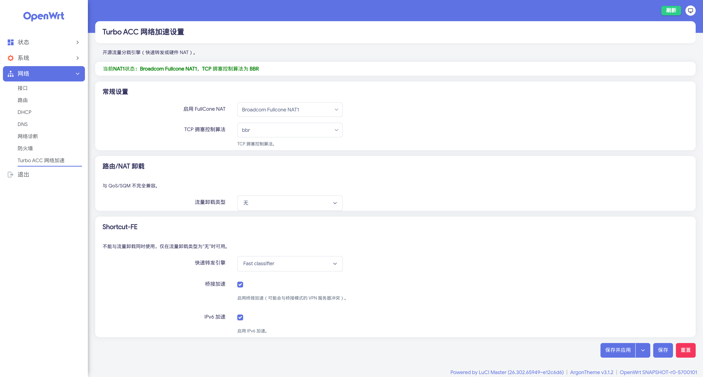
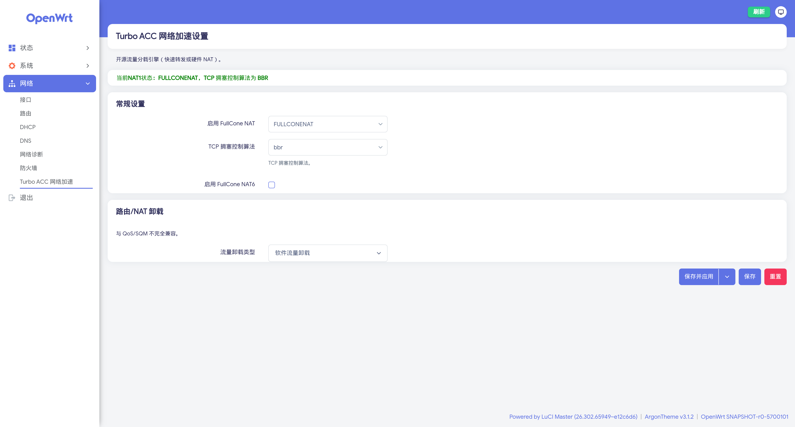

# luci-app-turboacc

简体中文 | [English](./README.en.md)

一个适用于官方Official OpenWrt(24.10/25.12/snapshot) firewall3/firewall4的turboacc
包括以下功能：快速转发引擎、全锥形 NAT1、TCP 拥塞控制算法
支持内核版本：6.6、6.12、6.18

> **如果只需要全锥形 NAT 功能而不需要 turboacc 的其他加速引擎**，可以使用独立项目 **[openwrt-sonic-fullcone](https://github.com/mufeng05/openwrt-sonic-fullcone)**。该项目基于 SONiC 的 fullcone NAT 内核补丁，支持 fw3/fw4 双防火墙、per-zone 和 per-protocol 粒度控制、LuCI Web 界面配置，且无需额外内核模块。

最近一次测试：2026-11-03 用 x86_64 平台的 snapshot 版本 OpenWrt（r0-5700101，Linux 6.18.55）分别编译了 fw3(iptables) 和 fw4(nftables) 固件，在 QEMU 中实测设置页面（含在页面上保存并应用）、全锥形 NAT1 的各模式、软件流量卸载、Fast Classifier（fw3）、TCP 拥塞控制算法和从旧版升级的设置迁移均正常，尚未在真机上测试

## 使用方法

+ 在openwrt源代码所在目录执行：

    ```bash
    curl -sSL https://raw.githubusercontent.com/mufeng05/turboacc/main/add_turboacc.sh -o add_turboacc.sh && bash add_turboacc.sh
    ```

    脚本会自动读取当前源码树的内核版本以及 firewall4、nftables、libnftnl 的版本，并匹配对应的补丁。

+ 之后执行

```bash
make menuconfig
```

+ 在 > LuCI > 3. Applications中选中luci-app-turboacc

## 设置页面

lede 移除 luci-app-turboacc 之后，把全锥形 NAT1、TCP 拥塞控制算法和流量卸载的设置并进了防火墙页面。本仓库的 TurboACC 页面移植了 lede 当前防火墙页面中的这部分内容，界面文字和中英文翻译都与 lede 一致：

+ 页面顶部：当前的 NAT1 状态和 TCP 拥塞控制算法
+ 常规设置：启用 FullCone NAT（`FULLCONENAT` / `Broadcom Fullcone NAT1`）、TCP 拥塞控制算法、启用 FullCone NAT6（仅 fw4）
+ 路由/NAT 卸载：流量卸载类型（软件流量卸载、硬件流量卸载，设备支持时还有 MediaTek HNAT、Qualcomm NSS ECM）
+ Shortcut-FE：Fast classifier / SFE connection manager、桥接加速、IPv6 加速。lede 已不再提供这部分，这里保留的是 lede 最后一版 turboacc 的设置，只在流量卸载类型为“无”时可用

前三部分与 lede 一样直接保存在防火墙配置中（`/etc/config/firewall` 的 `defaults` 节：`fullcone`、`fullcone6`、`tcpcca`、`flow_offloading`、`flow_offloading_hw`），Shortcut-FE 的设置保存在 `/etc/config/turboacc`。TCP 拥塞控制算法在 fw4 下由防火墙应用（lede 的 firewall4 补丁），在 fw3 下由 turboacc 应用。首次安装时，固件中有相应模块的话，默认开启兼容模式全锥、软件流量卸载和 BBR；从旧版升级时会自动迁移原来的设置。

## 注意

1. **优先使用 `Flow Offloading`**：`Flow Offloading` 是 Linux 内核原生的流量卸载方案（4.16+ 引入），兼容 nftables，支持进一步卸载到硬件，是长期推荐的加速方案。
2. **`firewall4`(nftables) 环境下请使用 `Flow Offloading`**：`Shortcut-FE` 和 `Fast Classifier` 依赖 iptables 时代的 conntrack chain events 接口，与 nftables 不兼容。OpenWrt 23.05+ 默认使用 `firewall4`/nftables，在此环境下选择 SFE 类方案会存在兼容性风险。
3. **仅在 `firewall3`(iptables) 环境下可选 `Fast Classifier` 或 `Shortcut-FE`**：如果你的固件使用的是 `firewall3`/iptables，可以先把流量卸载类型设为“无”，再在 Shortcut-FE 部分选择 `Fast classifier` 或 `SFE connection manager`。
4. 因OpenWrt现在使用`firewall4`作为默认防火墙，如果切换为`firewall3`的话，请把所有与nft相关的包手动取消掉，并替换为相应的ipt包(例如: `iptables-nft`替换为`iptables-zz-legacy`)。
5. **全锥形 NAT1 的两种模式在 `firewall3` 和 `firewall4` 下均可使用**，实现与 lede 当前版本一致：`FULLCONENAT`（兼容）模式使用全锥形 NAT 内核模块（fw3 为 `xt_FULLCONENAT`，fw4 为 `nft_fullcone`）；`Broadcom Fullcone NAT1` 模式由内核补丁实现，fw4 下对应 nftables 的 `masquerade fullcone`（lede 于 2026-10-03 加入）。fw4 启动时会先检测所选模式是否可用，不可用时自动回退为普通 masquerade。早期版本缺少 fw4 下 Broadcom 模式所需的补丁，会出现 [#11](https://github.com/mufeng05/turboacc/issues/11) 中的问题。`firewall4` 还支持 IPv6 全锥形 NAT（NAT6），在页面上勾选“启用 FullCone NAT6”即可。

## 插件预览




## 关于

此仓库的luci-app-turboacc是基于lede的[luci-app-turboacc](https://github.com/coolsnowwolf/luci/tree/d27cdc8ce2513e2caebda0fb60d8fddcd82eca01/applications/luci-app-turboacc)和chenmozhijin的[turboacc](https://github.com/chenmozhijin/turboacc)修改而来的。上游已于2026-10-29从coolsnowwolf/luci的openwrt-25.12分支中移除luci-app-turboacc，相关设置并入了防火墙页面；此仓库的设置页面改为移植 lede 防火墙页面中的对应部分，并保留了 lede 最后一版 turboacc 的 Shortcut-FE 设置。MediaTek HNAT 和 Qualcomm NSS ECM 的设置方式也与 lede 防火墙页面相同，旧版中 HNAT 的子选项和 MTK WED 选项随之移除。

## 感谢

 感谢以下项目：

+ [openwrt/openwrt](https://github.com/openwrt/openwrt)
+ [coolsnowwolf/lede](https://github.com/coolsnowwolf/lede)
+ [coolsnowwolf/luci](https://github.com/coolsnowwolf/luci)
+ [chenmozhijin/turboacc](https://github.com/chenmozhijin/turboacc)
